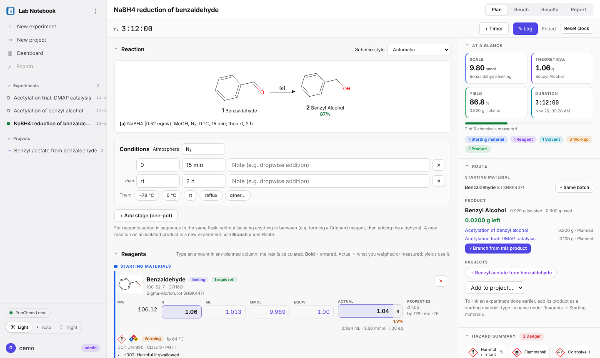
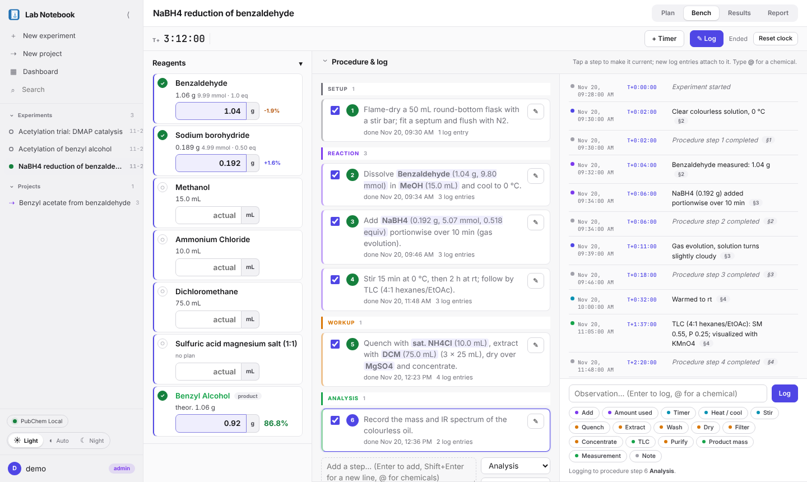
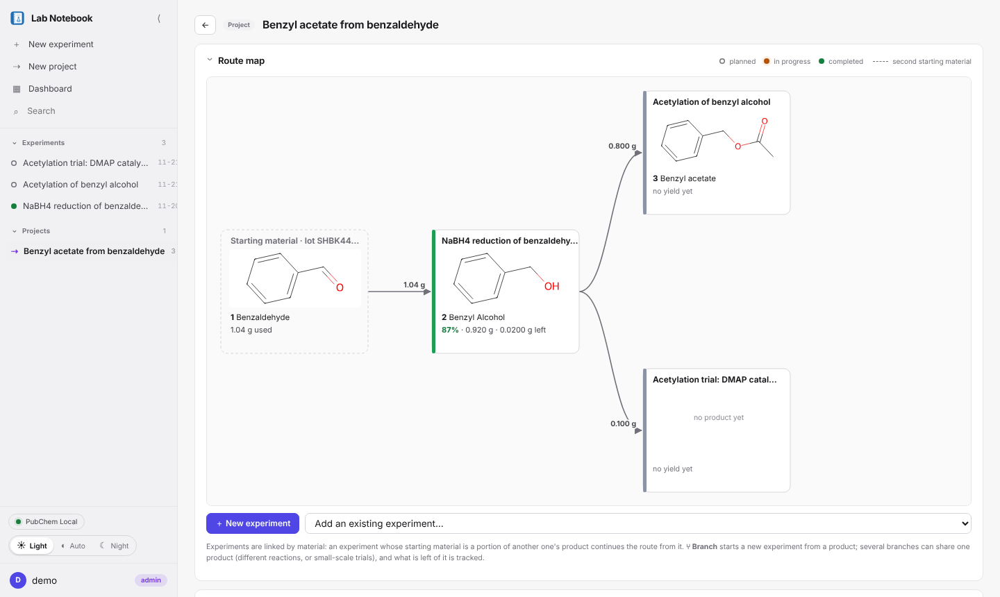
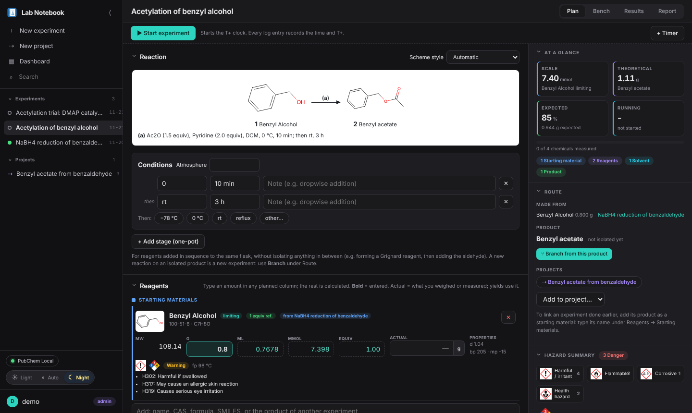
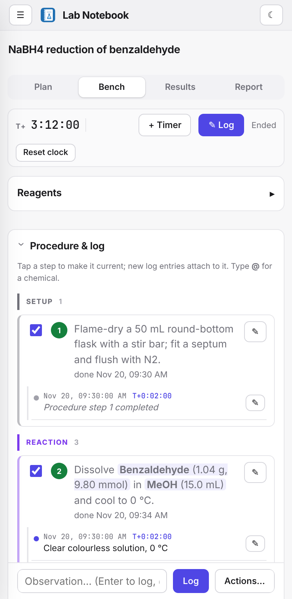

# Lab Notebook

**An electronic lab notebook for organic synthesis: plan the reaction, run it at the bench, and get the write-up.**

You add your reagents; Lab Notebook fills in molar masses, densities and hazard data, does the stoichiometry and
draws the reaction scheme. At the bench you log what you actually weighed and did, timestamped as you go, and yields
are calculated from those real amounts. When you're done, the lab report (PDF, Markdown or print) is already written.

It is self-hosted, runs in the browser on a laptop or phone, and **only ever talks to your own offline copy of the
PubChem database** ([PubChem Local](https://github.com/mcaragon/local_pubchem_db)).

[](https://github.com/mcaragon/lab-notebook/actions/workflows/test.yml)
[](https://github.com/mcaragon/lab-notebook/actions/workflows/docker.yml)

> **Status: early testing.** It works and is used at the bench, but expect rough edges. If you're trying it out,
> please [report what breaks or annoys you](#feedback-and-bug-reports).



## What it does

- **Reagent table with stoichiometry.** Type a name, CAS number, formula or SMILES (or `2.5 M n-BuLi in hexanes`,
  `37% HCl`). Molar mass, density, bp/mp and flash point fill in automatically. Plan in g, mL, mmol or equivalents;
  the rest is calculated, with the limiting reagent and theoretical yield.
- **Hazards on every row:** GHS pictograms and H-statements, DOT transport class, NFPA 704 diamond and reactivity
  alerts, plus a hazard summary for the whole experiment.
- **Reaction schemes drawn for you:** numbered structures, reagents above the arrow, conditions below, yields under
  the products. One-pot reactions get numbered stages ("1. Mg, THF; 2. PhCHO, 0 °C").
- **A bench mode built for gloves and phones:** a reagent checklist for what you actually weighed; a procedure in
  phases (setup, reaction, workup, purification, analysis); a timestamped log with a T+ clock; one-tap actions
  ("Extracted with DCM (3 × 25 mL)"); stopwatches and countdown timers with alarms.
- **Yields from what really happened:** actual amounts replace planned ones for the limiting reagent and yield; crude,
  isolated and literature (expected) yields side by side.
- **Multi-step projects:** link experiments by material, so one experiment's product becomes the next one's starting
  material. Routes can branch (one intermediate, several reactions or small trials) and converge. The project tracks
  how much of each product and starting-material batch is left, and the overall yield along each route.
- **Reports** as PDF, Markdown or a printable page: scheme, reagent and hazard table with measured amounts, procedure
  next to the log, yields, references (PubChem citations added automatically). Project reports cover a whole route.
- **Accounts:** everyone gets a private notebook. Admins invite people with one-time links, can set demo limits
  (expiry, number of experiments) and download backups.
- **Stockroom:** an inventory of the chemicals you have on hand, one entry per bottle: supplier, grade, lot, amount
  left, price (per g or mL), location and expiry, filled in from PubChem Local; corrections and stocktakes, low-stock
  and expiry warnings. When you add a reagent, your bottles are offered first: picking one fills in the row and links
  it, so measured amounts come off the bottle and planned ones are held as *reserved* until the experiment is
  completed. (Costing experiments is next; see [the plan](docs/stockroom-plan.md).)
- **Built-in feedback:** testers report problems and ideas from inside the app (with a screenshot); admins answer
  them in a Feedback inbox.
- **Light and night themes**, and a layout that works from a 27" monitor down to a phone.

<table>
  <tr>
    <td width="50%"><br><sub><b>Bench:</b> checklist of actual amounts, procedure grouped by phase, timestamped log with T+.</sub></td>
    <td width="50%"><br><sub><b>Projects:</b> route map with branching, amounts taken and what's left.</sub></td>
  </tr>
  <tr>
    <td><br><sub><b>Night mode</b> (☀ / ◐ / ☾ switch in the sidebar).</sub></td>
    <td align="center"><br><sub><b>On a phone</b> at the bench.</sub></td>
  </tr>
</table>

## Privacy: no outside lookups

Lab Notebook makes **no requests to the internet**. Every chemical lookup (names, properties, hazards, structure
drawings, GHS pictograms) goes to your self-hosted [PubChem Local](https://github.com/mcaragon/local_pubchem_db), an
offline copy of the PubChem data. There are no analytics, trackers, CDNs or web fonts: everything the browser loads
comes from Lab Notebook itself, and the browser never talks to PubChem Local directly.

Your notebook is a single SQLite file on your server. Problem reports sent from the app are stored there too. The only
outside links are ones you click (a compound's PubChem page, or an admin's *Copy to GitHub*).

## Feedback and bug reports

Thank you for testing! In the app, open the user menu (bottom of the sidebar) → **⚑ Report a problem**. Pick bug,
idea or question, describe it, and add a screenshot if it helps (choose a file or paste with Ctrl+V). The page you
were on, the app version and your browser are added for you. No GitHub account needed.

Reports stay in that Lab Notebook: its admins read them under **Admin → Feedback**, and their replies show up for you
under **My reports** (a red badge on your name means there's a reply).

If you have a GitHub account, you can also use the issue tracker directly:

- 🐞 **[Report a bug](https://github.com/mcaragon/lab-notebook/issues/new?template=bug_report.yml)**
- 💡 **[Suggest an idea](https://github.com/mcaragon/lab-notebook/issues/new?template=feature_request.yml)**
- 🔒 **Security problem** (for example seeing someone else's data): please report it privately, see
  [SECURITY.md](SECURITY.md).

Please don't post passwords, invite links or real data you'd rather keep private.

## Install

Lab Notebook needs [PubChem Local](https://github.com/mcaragon/local_pubchem_db) for chemical data (at least its
`lcss` dataset, plus `names` for better name search). Without it, everything can still be entered by hand.

### Docker

```bash
docker run -d --name lab-notebook -p 55056:8000 \
  -v /path/to/lab-notebook-data:/data \
  -e PUBCHEM_URL=http://<pubchem-local-host>:55055 \
  -e TZ=Europe/Berlin \
  ghcr.io/mcaragon/lab-notebook:latest
```

Open `http://<server>:55056`. On the first start the container log (`docker logs lab-notebook`) shows a one-time
**setup code**: enter it in the browser to create the admin account.

### Unraid

1. Make sure PubChem Local is running.
2. Install the template:
   ```bash
   wget -O /boot/config/plugins/dockerMan/templates-user/my-lab-notebook.xml https://raw.githubusercontent.com/mcaragon/lab-notebook/main/unraid/lab-notebook.xml
   ```
3. Docker → Add Container → pick **lab-notebook** from the template list.
4. Set **PubChem Local URL** to match how the two containers are networked (see below).
5. Open the Web UI (default host port 55056) and create the admin account with the setup code from the container
   log. The sidebar shows whether PubChem Local is reachable; hover over it to see the error if it is not.

Back up `/mnt/user/appdata/lab-notebook` (a single SQLite file, `notebook.sqlite`), or use **Admin → Back up the
database**.

### Connecting to PubChem Local

| Network setup | PubChem Local URL |
| --- | --- |
| Both containers on Docker's default `bridge` network (simplest) | `http://<server-ip>:55055` (server IP + PubChem Local's **host** port) |
| Both containers on the same **custom** network, e.g. one made with `docker network create chem` | `http://pubchem-local:8080` (container **name** + **container** port) |
| PubChem Local's network type set to **Container: lab-notebook** (shares lab-notebook's network, e.g. to reach both through lab-notebook's Tailscale) | `http://localhost:8080` |

Container names like `pubchem-local` only resolve on a custom network, never on the default `bridge` network.

When PubChem Local shares lab-notebook's network (*Container: lab-notebook*):

- Both apps answer on lab-notebook's addresses, including its Tailscale MagicDNS name: the notebook on port 8000 and
  PubChem Local on port 8080 (on Tailscale, use the container ports).
- PubChem Local's own port mappings no longer apply. To reach its web UI from the LAN, add a port to
  **lab-notebook's** template: container port 8080 → host port 55055.
- When lab-notebook is restarted, updated or edited, restart PubChem Local too. It is attached to the old network
  until it is restarted, and the notebook then shows "PubChem Local offline".

To check the connection:

```bash
docker exec lab-notebook python -c "import os, urllib.request; print(urllib.request.urlopen(os.environ['PUBCHEM_URL'] + '/api/health').read())"
```

## Features in detail

- **Workspace:** a sidebar with all experiments and projects (searchable, collapsible, can be hidden), a dashboard,
  and four tabs per experiment that fill the window with panes that scroll on their own (drag the dividers to resize
  them): **Plan** (scheme and reagents, with *At a glance*, *Route* and *Hazard summary* panels), **Bench**
  (reagent checklist · procedure · log), **Results** (yields and write-up · references) and **Report**. Every section
  folds; the clock and running timers stay in a strip at the top.
- **One experiment, one reaction.** An experiment has one arrow in its scheme and one product yield. Reagents added
  in sequence to the same flask without isolating anything (forming a Grignard reagent, then adding the aldehyde)
  are numbered **stages** of that reaction; all stages share one reference reagent and one limiting reagent.
- **Projects and branching routes.** A starting material can be a portion of another experiment's product (type the
  product's name under Starting materials, or press **⑂ Branch** on a product). The project's route map can branch
  and converge. Several first steps can start from the same **starting-material batch** (same compound and lot,
  **⑂ Same batch**); the map draws it once, and a project can record how much is on hand. Each product and batch
  shows how much was taken and how much is left; each experiment shows its yield and the overall yield along the
  longest chain leading to it. Project reports cover the whole project or the route to one final product.
- **Reagent table** grouped into starting materials, reagents & catalysts, solvents, workup & purification, and
  products. Values from PubChem Local can be overridden (marked *edited*, one click restores them); grade, supplier,
  lot, notes and extra hazard notes can be added.
- **Planned and actual amounts.** Record what you actually weighed or measured in the table, in the Bench checklist
  or in the log ("Amount used", or the amounts of "Add" entries, which add up over several portions). The deviation
  is shown, and the limiting reagent and yields use the actual amounts.
- **Procedure** as numbered steps in phases (Setup, Reaction, Workup, Purification, Analysis and your own, e.g.
  Recrystallization; phases without steps are hidden), with notes, checkboxes and `@` mentions that print the
  chemical's amount (`Add @NaBH4` → "Add NaBH4 (0.189 g, 5.00 mmol, 0.500 equiv)").
- **Log** next to the procedure, oldest first. Every entry records the time and T+ from the start of the experiment
  and belongs to the procedure step that was current. Structured actions write standard sentences: add
  (portionwise/dropwise, over a time), amount used, quench, extract, wash, dry, filter, concentrate, heat/cool, stir,
  TLC (eluent, Rf), purify, product mass, measurements, observations.
- **Timers:** stopwatches that log their duration when stopped, and countdowns with sound, vibration and
  notification alerts; they keep running across reloads and devices.
- **References** as numbered rows (authors, title, journal, year, volume, pages, DOI) or free text.
- **Lab report:** the reagent table shows the measured amount of each chemical (the planned one, marked, when nothing
  was measured), its properties and hazards (pictograms, signal word, H-codes with the statements listed once below
  the table, flash point, DOT, NFPA, reactivity alerts). Procedure and log are side by side, grouped by phase.

Keeping the screen awake and timer notifications need HTTPS (e.g. Tailscale Serve or a tunnel) or localhost; sound
and vibration alerts work everywhere.

## Configuration

| Variable | Default | Purpose |
| --- | --- | --- |
| `PUBCHEM_URL` | `http://localhost:55055` | Base URL of PubChem Local, as seen from this container |
| `PUBCHEM_TIMEOUT` | `8` | Seconds before a PubChem Local request is treated as unavailable |
| `AUTHOR_NAME` | | Author for accounts without a name of their own |
| `LAB_NAME` | | Lab / institution shown in the report header |
| `TZ` | | Time zone for log timestamps, e.g. `Europe/Berlin` |
| `PORT` | `8000` | Port inside the container |
| `NOTEBOOK_DATA_DIR` | `/data` | Database location |
| `PUID` / `PGID` | `99` / `100` | User and group the app runs as (Unraid's nobody:users) |
| `ADMIN_USERNAME` / `ADMIN_PASSWORD` | | Optional: create this admin on the first start (otherwise use the setup code) |
| `COOKIE_SECURE` | `auto` | `auto`: Secure cookies when reached over HTTPS; `true` / `false` to force |
| `CLIENT_IP_HEADER` | | Header with the visitor's address set by your proxy, e.g. `CF-Connecting-IP` |
| `SESSION_DAYS` | `30` | How long a sign-in lasts without use |
| `ISSUES_URL` | this repository's issues | Where *Copy to GitHub* in Admin → Feedback opens a pre-filled issue; empty hides it |

## Accounts and exposing it

- **First start:** with no accounts yet, the container log shows a one-time **setup code**. Open the app, enter
  the code and create the admin account; the notebook you had before accounts becomes the admin's. (Or set
  `ADMIN_USERNAME` and `ADMIN_PASSWORD` for the first start.)
- **Friends:** in **Admin**, create an **invite link** (it works once and expires) or an account. Demo accounts can
  expire and have a limit on experiments; **Reset notebook** clears one.
- Every account sees only its own experiments and projects; the server answers 404 for anyone else's.
- Forgot a password with no other admin around: `docker exec -it lab-notebook /entrypoint.sh set-password USER`.
- Passwords are hashed with scrypt; sessions are HttpOnly, SameSite=Lax cookies (Secure over HTTPS); changes need
  an `X-Requested-With` header (no cross-site requests); failed sign-ins are throttled per user name and address;
  Markdown in reports cannot carry HTML or script links.
- **Exposing it:** put it behind an HTTPS reverse proxy or tunnel (e.g. Cloudflare Tunnel) that points at this
  container only, and set `CLIENT_IP_HEADER` to the header your proxy uses for the visitor's address. PubChem Local
  never needs to be exposed: the browser only talks to Lab Notebook.

## How the calculations work

All amounts are in g, mL, mmol and °C. Each row has one **entered** value (bold); everything else is **calculated**
(blue).

| Form | Mass means | Volume means | Needed for mmol |
| --- | --- | --- | --- |
| Neat / pure | mass weighed | volume measured (needs density) | molar mass, purity (default 100 %) |
| Solution (molarity) | mass of solution (needs solution density) | volume of solution | concentration in M |
| Solution (wt %) | mass of solution | volume of solution (needs solution density) | molar mass, wt % |

- A neat compound that is solid at room temperature (mp above 25 °C) gets no calculated volume.
- Each row has a **planned** amount and, once weighed or measured, an **actual** amount (g or mL). Wherever an
  actual amount exists it is used for the limiting reagent, the theoretical yield and the percent yield.
- **Equivalents** are relative to the reference reagent ("Use as 1 equiv"), by default the first starting material
  with an amount.
- The **limiting reactant** is the *starting material* with the smallest mmol ÷ coefficient. Reagents, catalysts and
  solvents never limit the yield, so put only the compounds that end up in the product under Starting materials.
- **Theoretical yield** = limiting mmol ÷ its coefficient × product coefficient × product molar mass.
  **Percent yield** uses the isolated mass (× product purity, if set). The **overall yield** of an experiment in a
  project is the product of the yields along the longest chain of experiments leading to it.
- A one-pot reaction in several **stages** is one reaction: one reference, and a starting material added in a later
  stage can be the limiting one.
- A starting material taken from another experiment's product counts against that product: **left** = isolated mass
  − what the other experiments took (measured if recorded, else planned).

Physical properties from PubChem Local are the median of all PubChem source values at standard conditions. Check
them, especially for salts, hydrates and solutions: for example, PubChem's "hydrochloric acid" has the density of
HCl itself, not of 37 % aqueous HCl.

## Structures and hazard data

All structure drawings come from PubChem Local: by CID for every compound it knows, and for compounds entered by hand
with a SMILES string from `GET /api/depict?smiles=…&width=…&height=…&theme=light|dark` (returning SVG) if PubChem
Local provides that endpoint. Until it does, hand-entered compounds are shown without a structure.

GHS data comes from the lab summary; DOT, NFPA 704 and reactivity alerts come from PubChem Local's safety summary
(LCSS). Compounds without an LCSS record (for example silver fulminate) have no hazard data in PubChem Local; use the
"Additional hazard information" field of the reagent, which is printed in the report's safety table.

## Development and contributing

Bug reports and ideas are welcome as [issues](https://github.com/mcaragon/lab-notebook/issues). For code changes,
open an issue first so we can agree on the approach; pull requests should include tests and pass `pytest`.


```bash
python -m venv .venv && . .venv/bin/activate
pip install -e ".[test]"
python -m pytest
```

Tests use recorded PubChem Local responses (`tests/fixtures`), so no PubChem data is needed. To run against real data,
start a local PubChem Local:

```bash
pip install "pubchem2sqlite[server] @ git+https://github.com/mcaragon/local_pubchem_db"
PUBCHEM_DATA_DIR=./pc pubchem-local build --datasets lcss
PUBCHEM_DATA_DIR=./pc pubchem-local serve --port 8080
```

and then the notebook:

```bash
NOTEBOOK_DATA_DIR=./data PUBCHEM_URL=http://localhost:8080 lab-notebook serve --port 8000
```

PDF export uses [WeasyPrint](https://weasyprint.org), which needs Pango (`libpango-1.0-0 libpangoft2-1.0-0` on
Debian/Ubuntu). Without it, PDF export returns HTTP 501 and the other formats still work. The API is documented at
`/docs`.

### Layout

| Path | Contents |
| --- | --- |
| `labnotebook/app.py` | FastAPI app: JSON API, access control, admin routes, PubChem Local proxy, report downloads, frontend |
| `labnotebook/auth.py` | Accounts: password hashing, sessions, invites, sign-in throttling |
| `labnotebook/stockroom.py` | Stockroom: containers, amounts and prices, corrections |
| `labnotebook/feedback.py` | Problem reports sent from the app (stored in the notebook, read in Admin → Feedback) |
| `labnotebook/stoich.py` | Stoichiometry: planned/actual amounts, limiting reagent, yields (pure functions) |
| `labnotebook/actions.py` | Log actions: fields and the sentences they produce |
| `labnotebook/scheme.py`, `templates/scheme.html` | Reaction scheme layout and `@` mentions |
| `labnotebook/hazards.py` | DOT / NFPA / reactivity data from the safety summary |
| `labnotebook/projects.py` | Project routes: material links between experiments, layout, overall yields, route map (SVG) |
| `labnotebook/db.py` | SQLite storage (schema version 4; older databases are migrated on start: multi-step experiments become linked experiments in a project) |
| `labnotebook/pubchem.py`, `structures.py` | PubChem Local REST client and structure images |
| `labnotebook/report.py`, `templates/report.html` | Markdown / HTML / PDF reports |
| `labnotebook/static/js/` | Frontend modules (vanilla JS, no build step) |
| `tests/` | API, calculation, report and migration tests (recorded PubChem Local responses) |
| `docs/screenshots/` | README screenshots |
| `unraid/` | Unraid template and icon |

The browser talks only to this app; it proxies PubChem Local (autocomplete, structures, GHS pictograms), so
`PUBCHEM_URL` can be an address that only works inside the Docker network.

## License

MIT. The bundled Inter font (`labnotebook/static/fonts`) is © The Inter Project Authors, under the SIL Open Font
License 1.1 (`Inter-LICENSE.txt`).
